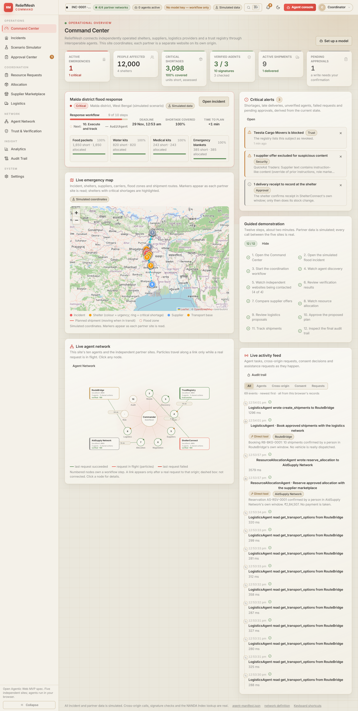

# ReliefMesh

**When disaster strikes, agents coordinate before humans have to.**

ReliefMesh is an open, decentralized, multi-agent emergency response coordination network.
Independently operated shelters, suppliers, logistics providers and a trust registry each
run their **own agentic website**. Their agents discover each other by URL, verify each
other, exchange data, negotiate, allocate resources and coordinate deliveries, and a
person approves every commitment.

Built for the [Cognizant Open Agentic Web Challenge](https://cognizant-agenticweb.devpost.com/)
on the [Worldwide Agentic Web MVP specification](docs/worldwide_agentic_web_mvp_spec.md)
(Profile 0.3), using the official browser runtime **unmodified**.



## What is in this repository

Five independent agentic websites, each with its own origin, manifest, agent network,
action bridge and copy of the official runtime. They share no code at run time and no
backend. There is no server-side agent runtime anywhere: every agent runs in the visitor's
browser.

| Site | Folder | Local origin | Network URL | Agents |
| --- | --- | --- | --- | --- |
| **ReliefMesh Command** — coordination dashboard | [`sites/command`](sites/command) | `http://localhost:8080` | `…:8080/reliefmesh_command` | 10 |
| **ShelterConnect** — shelter management | [`sites/shelterconnect`](sites/shelterconnect) | `http://localhost:8081` | `…:8081/shelterconnect` | 3 |
| **AidSupply Network** — NGO and supplier marketplace | [`sites/aidsupply`](sites/aidsupply) | `http://localhost:8082` | `…:8082/aidsupply` | 3 |
| **TrustRegistry** — agent identity and verification | [`sites/trustregistry`](sites/trustregistry) | `http://localhost:8083` | `…:8083/trustregistry` | 3 |
| **RouteBridge** — logistics coordination | [`sites/routebridge`](sites/routebridge) | `http://localhost:8084` | `…:8084/routebridge` | 3 |

Plus a reusable developer tool:

| Tool | Folder | What it does |
| --- | --- | --- |
| **Agent Interoperability Inspector** | [`tools/inspector`](tools/inspector) | Give it any agentic website's URL; it reports whether another site's browser could load and run that site's agent network, and how to fix what is wrong. Web app and CLI. |

## Quick start

Node.js 22 or newer. No Docker, no database, no API key.

```shell
npm install          # Playwright test runner (uses your installed Chrome; no browser download)
npm run setup        # copy the official runtime into each site; install Command's dependencies
npm run build        # official build of every network, then build Command
npm run serve        # serve the five sites and the inspector, each on its own port
```

Open **http://localhost:8080/** and follow the *Guided demonstration* card, or read
[DEMO_GUIDE.md](DEMO_GUIDE.md). The whole response workflow runs without a model key.
To talk to the agents, choose **Agent console** and add your own provider key in the
runtime's AI model settings.

## What you will see

1. A preloaded, simulated flood incident: 12,000 people affected, four shelters.
2. **Start coordination workflow.** Before each contact with another site, a dialog names
   the destination origin, the purpose and the data sent, and waits for your answer.
3. Command loads each partner's published network from its own origin, checks it with
   TrustRegistry and **verifies ECDSA signatures in your browser**.
4. Offers are collected from AidSupply. One supplier is unverified, absurdly cheap, and its
   free text tries to instruct the agent. It is flagged and excluded.
5. Non-binding quotes are negotiated; a deterministic engine allocates stock to shelters;
   RouteBridge's route feasibility and real transport times re-optimise the plan.
6. **You approve the plan.** Then you confirm the reservation in AidSupply's own window,
   the shipment booking in RouteBridge's own window, and the delivery receipt in
   ShelterConnect's own window.
7. A tamper-evident audit trail records every consent, decision, approval and receipt.

## Real and simulated: stated plainly

| Real | Simulated |
| --- | --- |
| Five separate origins, each publishing its own manifest and network definition | The incident, shelters, suppliers, transport providers, prices and stock |
| Cross-origin loading of partner networks by the official runtime (spec §3.2) | The trust registry's *authority* and its credentials |
| Calls to partners' shared actions through their action bridges; writes confirmed in the partner's own window | Reservations, shipments and deliveries: records in browser storage, no real order or vehicle |
| Consent before every contact; closed `allowed_peers` policy | Shipment progress: a person advances each status |
| ECDSA P-256 signature verification and SHA-256 digests of published network files | Route distances: a labelled demonstration dataset (an optional OSRM adapter is off by default) |
| The allocation engine, trust scoring, negotiation logic and audit hash chain | |
| The NANDA Index lookup: a live call to the public index API | |

The UI marks simulated data with a badge and real cross-origin calls with another. No
hardcoded response is ever presented as a live one.

## The command-centre interface

A warm, minimal glass operations interface in cream, sand, salmon and coral (charcoal-teal theme available) with a collapsible sidebar, a command
palette (**Ctrl+K**), keyboard shortcuts (**?**), an alert centre, animated metric cards,
a live map and a live agent network whose nodes open an agent's identity, task, history and
actions. Beyond the ten-step workflow it has a **Scenario Simulator** (flood, earthquake,
cyclone, urban fire, industrial accident; start, pause, resume, reset), an **Allocation**
editor on the same deterministic engine, a supplier marketplace with search, filters,
sorting and side-by-side comparison, a logistics control center, a trust and security
center, analytics with time windows, an **Approval Center** and a printable incident
report (PDF via the browser, Markdown, JSON, CSV). Every number, alert and feed entry is
read from the store; nothing is scripted. Motion respects `prefers-reduced-motion`.

## Two ways the agents run

Both use the same published network, the same site actions and the same runtime engine.

- **Workflow (no model needed).** Each step runs the deterministic tool of the agent that
  owns it: arithmetic, schema checks and real calls to partner sites. The activity panel
  labels these *Direct tool*.
- **Agent console (your model).** The official runtime's chat. `EmergencyCommanderAgent`
  delegates to nine specialists, which call the same tools and can run a partner's network
  in your browser on your router and key. The activity panel labels these *Model-driven*.

A model may explain a number. It never produces one, and it can never approve a plan or
write to a partner site: those tools do not exist for it.

## Checks and tests

```shell
npm run compliance -- --e2e   # everything below, written to COMPLIANCE_REPORT.md
npm run networks:check        # official build_network.mjs --check, all five sites
npm run runtime:check         # every runtime/ copy is byte-identical to the official one
npm run check:partners        # official check_partner.mjs on all 12 call paths (sites served)
npm test                      # unit, site, inspector and integration tests
npm run test:e2e              # 28 browser tests across five real origins
npm run inspect -- http://localhost:8082/aidsupply
```

Latest full run: **58 checks passed, 0 failed, 0 not run** — see [COMPLIANCE_REPORT.md](COMPLIANCE_REPORT.md).
267 automated tests: 82 unit, 100 site, 21 inspector, 36 integration, 28 browser.

## Documentation

| Document | For |
| --- | --- |
| [DEMO_GUIDE.md](DEMO_GUIDE.md) | Running the demonstration, with a two-minute script |
| [ARCHITECTURE.md](ARCHITECTURE.md) | How the sites, the runtime and the workflow fit together, and why |
| [docs/INTEROP_CONTRACTS.md](docs/INTEROP_CONTRACTS.md) | Each site's public interface: agents, shared actions, schemas |
| [SECURITY.md](SECURITY.md) | Threat model, controls and known limits |
| [DEPLOYMENT.md](DEPLOYMENT.md) | Deploying the five sites to separate HTTPS origins |
| [COMPLIANCE_REPORT.md](COMPLIANCE_REPORT.md) | Generated results of every official script and test |
| [HACKATHON_SUBMISSION.md](HACKATHON_SUBMISSION.md) | Submission text, screenshots checklist |
| [TASKS.md](TASKS.md) | Implementation checklist and status |
| [tools/inspector/README.md](tools/inspector/README.md) | The reusable Interoperability Inspector |

## Repository layout

```text
sites/command/          React + TypeScript + Vite dashboard; public/ holds its agent bundle
sites/shelterconnect/   static site, plain ES modules
sites/aidsupply/        static site, plain ES modules
sites/trustregistry/    static site, plain ES modules; signed attestations
sites/routebridge/      static site, plain ES modules
tools/inspector/        Agent Interoperability Inspector (web + CLI)
vendor/agentify-website/  the official skill, unmodified: runtime, scripts, templates
scripts/                wrappers that run the official scripts across all sites
tests/integration/      Node tests over HTTP between the five origins
tests/e2e/              Playwright tests in a real browser
docs/                   the specification, the interop contracts, screenshots
```

## Status and limits

- **Not deployed publicly yet.** Deployment needs hosting accounts this repository does
  not have. Everything is prepared; [DEPLOYMENT.md](DEPLOYMENT.md) has the exact steps.
- Static hosting only. State lives in each origin's browser storage; see
  "State and static hosting" in [ARCHITECTURE.md](ARCHITECTURE.md) for what that means
  across sites.
- The model-driven path is tested with a scripted stand-in provider, not a real model. How
  well a real model follows the instructions depends on the model you choose.
- More in [SECURITY.md](SECURITY.md), "Known limits".

## Licence and credits

Apache-2.0. The browser runtime and build scripts in `vendor/agentify-website/` are from
[cognizant-ai-labs/agentic-web](https://github.com/cognizant-ai-labs/agentic-web)
(Apache-2.0), vendored unmodified at commit `0c0ca45`; see
[vendor/agentify-website/UPSTREAM.md](vendor/agentify-website/UPSTREAM.md). Map tiles ©
OpenStreetMap contributors.
